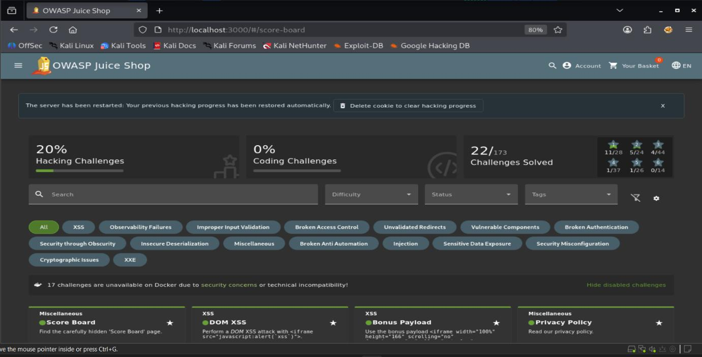
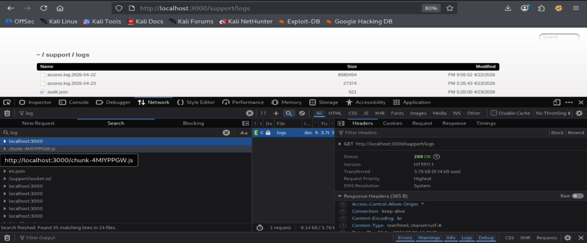
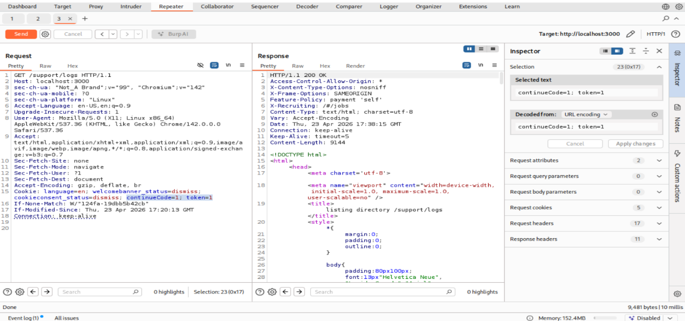
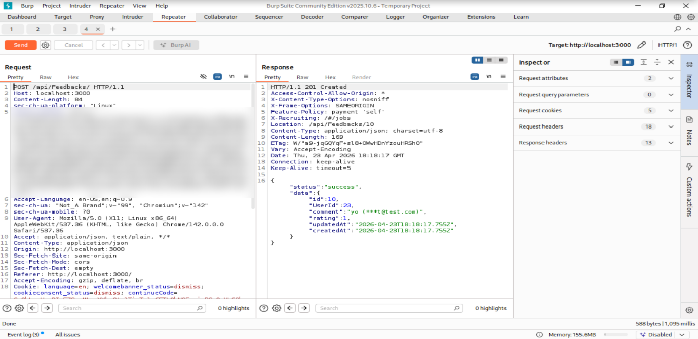
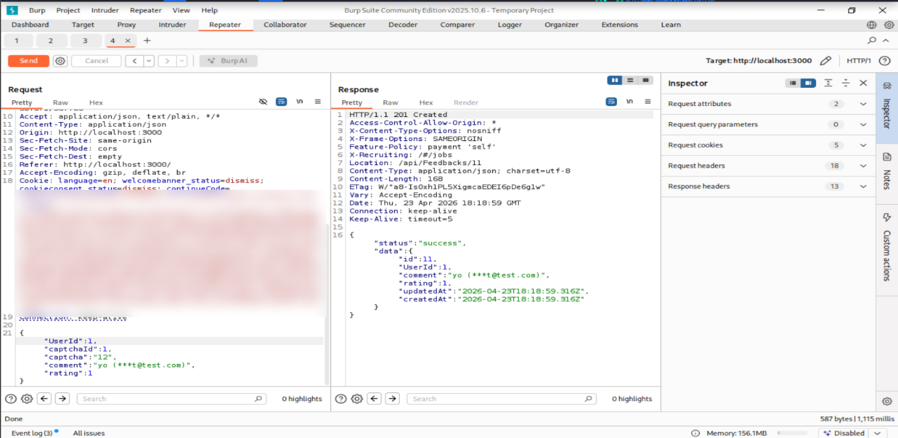

# OWASP Juice Shop security assessment

Security testing of [OWASP Juice Shop](https://owasp.org/www-project-juice-shop/), a deliberately vulnerable web shop, for the Web Application Security module (COMP H2704) at TU Dublin, April 2026. I worked in a group of four. We each attacked the app on our own, then combined our findings with a static code scan (SAST) and a dynamic scan (DAST) into a 7,000-word technical report.

On my own instance I solved 22 of the 173 challenges, including the 4-star Access Log challenge. I wrote up five of them for the report and documented two in full.

## What I did

- Ran Juice Shop locally in Docker and tested it from Kali Linux, using Burp Suite Community and the Firefox developer tools
- Solved 22 challenges (11 one-star, 5 two-star, 4 three-star, 1 four-star, 1 five-star)
- Wrote up five challenges in the group's findings table, each with a CWE mapping and a proposed fix
- Wrote the full analysis for Access Log and Forged Feedback: root cause, how I found it, the exploit, impact and mitigation

| Challenge | Vulnerability | How I solved it | Fix proposed |
| --- | --- | --- | --- |
| Access Log (4-star) | Sensitive data exposure, CWE-532 | Guessed directory paths, found `/support/logs` | Store logs outside the web root, restrict access |
| Forged Feedback (3-star) | Broken access control / IDOR, CWE-639 | Changed `UserId` in the request in Burp Repeater | Take user identity from the JWT, not the request body |
| Forged Review (3-star) | Broken access control, CWE-639 | Tampered with the review request | Server-side authorisation checks on the session |
| Login Amy (3-star) | Sensitive data exposure, CWE-200 | OSINT to work out her password | Block guessable passwords, enforce a strong policy |
| Login Jim (3-star) | SQL injection, CWE-89 | SQL injection payload in the login email field | Parameterised queries, input validation |

## Finding 1: Access Log (CWE-532)

The server writes every HTTP request to an access log and serves the log folder to anyone who asks for it. No login, no access check.

**How I found it.** While solving the Confidential Document challenge I noticed that `/ftp` was publicly browsable. If one internal folder was open, others might be too. I tried common paths in the address bar (`/logs`, `/log`, `/access.log`, `/support/logs`) and watched the Network tab for hints. `/support/logs` returned a full directory listing with the access logs in it, served as `200 OK`.

**Impact.** The log holds full URLs with query strings, IP addresses, user agents and timestamps. Any session token or API key that ends up in a URL can be stolen and replayed. It also maps out the API and shows when admins log in. Personal data in the logs would be a GDPR problem.

**Fix.** Keep logs outside the web root and put admin authentication in front of any log viewer. Don't log tokens, passwords or session IDs at all. Ship logs to a central log server rather than leaving them on the web server, and add directory scanning to the CI/CD pipeline so exposed folders get caught before release.

The group's Semgrep scan later found the cause in the code: `server.ts` turns on directory listing for `/support/logs` (rule `express-check-directory-listing`, CWE-548).

## Finding 2: Forged Feedback (CWE-639)

The feedback form sends the user's ID in the JSON body, and the server trusts it. Any logged-in user can post feedback as anyone else.

**How I found it.** I made an account, submitted feedback through the Contact page and captured the `POST /api/Feedbacks/` request in Burp. The body had `comment`, `rating` and `UserId` fields. A server shouldn't need the client to say who it is, since it already has the session token.

**Exploit.** In Burp Repeater I changed `UserId` from my own ID (23) to 1, which is normally the admin account in Juice Shop, and resent it. The server replied `201 Created` and stored the feedback under user 1.

**Impact.** An attacker can post abuse or fake complaints in another user's name, or send a phishing link that looks like it came from an admin. An IDOR on one endpoint usually means others are worth checking for read, edit and delete access to other users' data.

**Fix.** Never accept `UserId` from the client. Work out the user from the JWT or session issued at login, check authorisation on every request that changes account data, and log the real session identity for each submission (OWASP Proactive Control C7, ASVS V4).

## Group work: SAST and DAST

[Abhijeet: say here which parts of the scanning you ran yourself. If you didn't run them, keep this section short and say it was group work.]

- **SAST:** Semgrep 1.160.0 against all 1,046 files in the Juice Shop source. The auto ruleset (1,059 rules) gave 38 findings and the OWASP Top 10 ruleset gave 18. We traced three of them back to challenges: SQL injection in `routes/login.ts` line 34, hardcoded HMAC and JWT secrets in `lib/insecurity.ts`, and directory listing in `server.ts`.
- **DAST:** OWASP ZAP 2.17.0, using manual explore, then the spider (1,107 URLs) and targeted active scans on the login, API and feedback endpoints. It raised 21 alerts: 1 High, 7 Medium, 6 Low and 7 Informational. The High was the same login SQL injection Semgrep found, which we confirmed by logging in as admin with `' OR 1=1--`.

## Tools

Kali Linux, Docker, Burp Suite Community 2025.10, Firefox developer tools, Semgrep, OWASP ZAP

## What I took from it

The most useful habit was asking why a value is in a request at all. The `UserId` field in the feedback request was the giveaway. Following one open folder (`/ftp`) to look for others is what led me to the logs. Seeing Semgrep point to the exact line behind an exploit I'd already pulled off by hand also showed me how static and dynamic testing find the same bug from opposite ends.

## Notes

- Testing was done on a local copy of an intentionally vulnerable training app. Don't use these techniques on systems you don't have permission to test.
- Session tokens in the screenshots are blurred.
